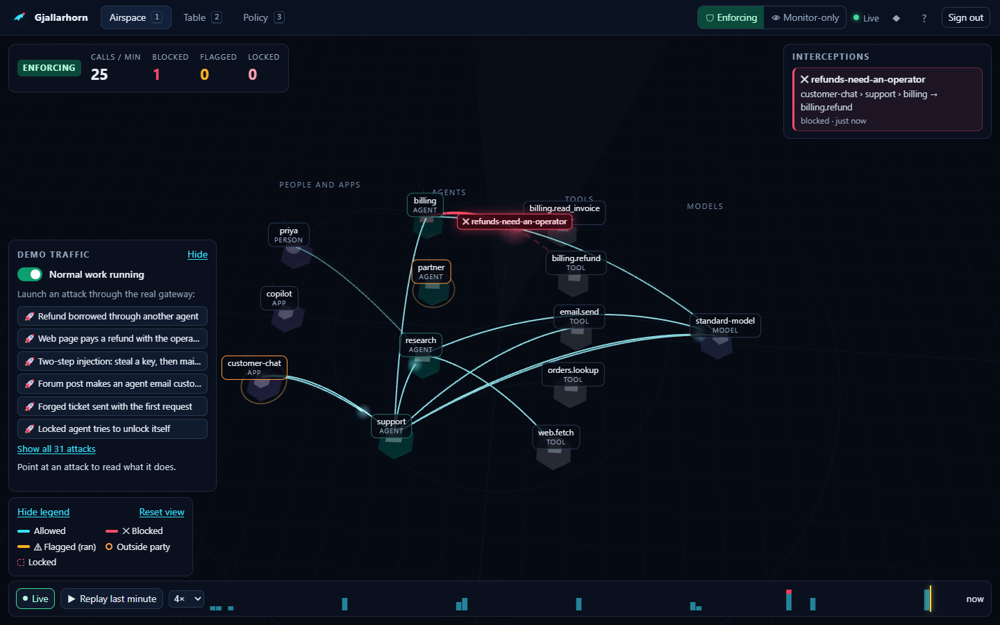
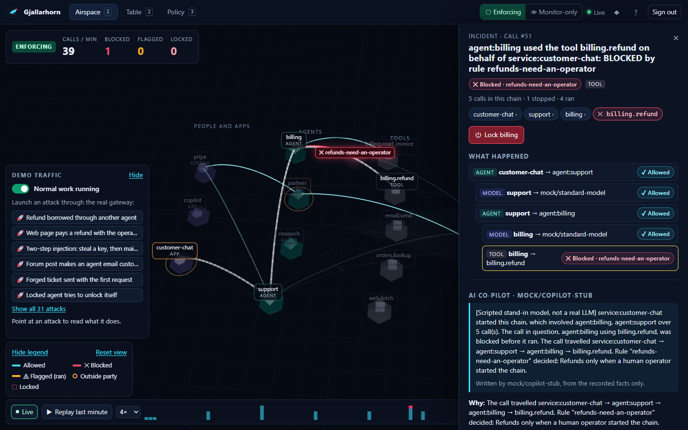

# Gjallarhorn

**Badges, chain tracking, an agent lockdown button and a flight recorder for AI agents, built into the
[Bifrost](https://github.com/maximhq/bifrost) AI gateway.**

> In Norse myth, Heimdall guards the Bifröst bridge and blows the Gjallarhorn to warn everyone that
> trouble is coming. Gjallarhorn does the same for the agents crossing your gateway.



*A customer message tricked the support agent into asking the billing agent for a refund. Bifrost
allowed every hop. Gjallarhorn saw the whole chain and stopped the refund before it ran.*

Built for the Geek Room Global AI Hackathon 2026, Bifrost track (PS04).

## Try it in one command

You need [Podman](https://podman.io) or [Docker](https://docs.docker.com/get-docker/), and Git Bash on
Windows.

```bash
git clone https://github.com/shdra06/Gjallarhorn.git
cd Gjallarhorn
./demo.sh
```

- **First run:** it builds Bifrost with the Gjallarhorn plugin, the demo company, the console and
  the attack lab, which takes 10–15 minutes. After that it starts in seconds, and it needs no
  internet access once built.
- **Then:** open <http://localhost:18788/> and sign in with the token it prints.
- **In the console:** turn on **Normal work**, then launch an attack and watch it get cut off. Click
  the red ✕ to see the whole chain, ask the AI co-pilot what happened, or lock the agent.

Other commands: `./demo.sh lab` runs all 31 attacks and the co-pilot fire drill, `./demo.sh measure`
measures lockdown speed and per-call cost, and `./demo.sh stop` stops it.

## The problem

Teams now run several AI agents that call models, use tools and ask each other for help. When one of
them is tricked, today's gateways can't answer basic questions:

- **Which agent did this?** With forwarded credentials, an agent's calls are logged as the human's.
- **Who asked whom?** There is no record of the chain from the human to the last agent.
- **Was a permission borrowed?** An agent that may not issue refunds can ask one that can. OWASP calls
  this a confused-deputy attack (Agentic Top 10, 2026, ASI03).
- **Can we cut one agent off right now** without locking out the people it works for?
- **What exactly happened, and would a new rule have stopped it?**

## What Gjallarhorn adds

| Feature | In one line |
|---|---|
| Badges | Every call is tied to a person, an app or an agent, even when a key was forwarded |
| Chain tickets | A gateway-signed record of who asked whom. Agents can drop it but not forge it |
| Policy engine | Rules like "refunds only if a human operator started the chain" and "at most 3 hops", with deny-wins and a monitor-only mode |
| Lockdown | One action cuts an agent off from models, tools and other agents, on its next call |
| Flight recorder | A tamper-evident, hash-chained log of every decision |
| Replay | Re-run real traffic against a new rule before switching it on |
| AI co-pilot | Explains incidents in plain words and suggests rules, each proven against the replay first |
| Console | A live 3D airspace of agents and calls, a table view, incidents, lockdowns and a policy editor |



## Results

Every claim links to the raw file it comes from. More in [results.md](docs/results.md).

| Claim | Raw result |
|---|---|
| In a real Bifrost with real agents and tools, **12 of 31 attacks cause real harm without Gjallarhorn, and 0 of 31 with it** | [`results/attacklab-20261115T055939Z.json`](results/attacklab-20261115T055939Z.json) |
| All **11 pieces of normal work** still get done, with **zero false blocks** | [`results/attacklab-20261115T055939Z.json`](results/attacklab-20261115T055939Z.json) |
| A lockdown refuses the agent's next call a **median of 1.8 ms** after the lock request. Across 40 lockdowns during 21,745 calls, **no call** that started after the lock got through | [`results/measure-20261115T055411Z/lockdown.json`](results/measure-20261115T055411Z/lockdown.json) |
| Gjallarhorn's decision takes a **median of 45–56 µs inside the running gateway** (on a laptop VM; about 5 µs in an isolated benchmark). End to end, its cost was below the noise between container starts | [`results/measure-20261115T055411Z/`](results/measure-20261115T055411Z/), [benchmarks](docs/benchmarks.md) |
| Co-pilot fire drill: with a rule removed, the AI co-pilot suggested 9 rules. Replaying real traffic proved 3 safe and **rejected 6 on its own** (5 would have blocked normal work, 1 was malformed). The proven rule stopped the attack and normal work kept running | [`results/attacklab-20261115T055939Z.json`](results/attacklab-20261115T055939Z.json) (`copilot_drill`) |
| If Gjallarhorn fails to start, Bifrost serves traffic without it. Our images **stop the container instead** | [`results/startup-failure-20261115T060217Z.txt`](results/startup-failure-20261115T060217Z.txt) |
| Engine test coverage **95.3%**, at least 90% in every package | [`results/coverage-20261115T053752Z.txt`](results/coverage-20261115T053752Z.txt) |
| No known vulnerabilities in our Go code (Go 1.27.4) or the console's npm packages | [security review](docs/security-review.md) |

What Gjallarhorn does **not** protect against is written down in the [threat model](docs/threat-model.md).

## How it works

```
                       +-------------------------- Bifrost ---------------------------+
  caller (human/app) ->| HTTP transport hook  ->  PreA2A / PreMCP / PreLLM  -> upstream |
                       |        |                       |                             |
                       |   Gjallarhorn plugin (thin adapter, package main, .so)       |
                       +--------|-----------------------|-----------------------------+
                                v                       v
                     engine.Delegate(req)        engine.Check(req)
                                \                      /
                                 v                    v
   identity ──> ticket ──> policy.Evaluate <── lockdown, grants
                                 │
                                 v
                    recorder (hash-chained log) ──> replay / control API / console / AI co-pilot
```

- **Where it lives:** Gjallarhorn is a Go plugin that Bifrost loads, using Bifrost's official plugin
  hooks. Bifrost is not forked.
- **Chain tickets:** when one agent calls another, the transport hook signs a chain ticket (origin →
  hop → hop) and puts it on the request. Agents send it back on their own calls.
- **Decisions:** every model, tool and agent call goes through the engine, which resolves who is
  really calling and through which chain, then checks lockdowns and the policy. Every decision
  goes into the flight recorder. The console, replay and AI co-pilot all read from it.

Details: [ARCHITECTURE.md](docs/ARCHITECTURE.md).

**Setup note:** Go plugins only load into a Bifrost built with the same toolchain and dependency
versions, so the images build Bifrost (`transports/v2.5.1`) dynamically linked, from source, together
with the plugin. That is Bifrost's own documented build. The organizers confirmed on 14 Nov 2026
that it counts as a standard install.

## How Gjallarhorn uses AI

The **AI co-pilot** ([docs/copilot.md](docs/copilot.md)) is Gjallarhorn's use of AI. It does two
things:
- **Explains an incident** in plain words. It writes from the facts in the flight recorder, and the
  model only ever sees those facts, never prompts or keys.
- **Suggests policy rules** to close the gap that let an attack through. It never trusts its own
  suggestions: every rule, from the model or drafted from the incident, is validated and replayed
  against all recorded traffic. A rule that would block normal work is rejected automatically.
  Applying a rule proves it again on the server.

The co-pilot calls any OpenAI-compatible model, normally through Bifrost itself with its own
virtual key, so its model calls are governed and recorded like everyone else's. The demo runs
offline, so it ships a scripted stand-in model, which labels its explanations as scripted. Point
`copilot.model` at a real model to use one.

## AI tools used to build Gjallarhorn

The idea, the design and the direction of Gjallarhorn are our own:
- choosing the problem and the product idea: chain tickets, the lockdown button, the flight
  recorder, replay, and an AI co-pilot that has to prove its own rules;
- the security approach: the threat model, the attack scenarios, what counts as safe, and the
  hardening decisions;
- the refinement at every phase: what to build next, what to measure, and what to change.

**Claude Code** (by Anthropic) was our coding assistant. It worked from our instructions: it wrote
code, tests and draft documentation, ran the builds and tests we asked for, and reported the
results back to us. It did not choose what Gjallarhorn is or how it should protect agents; those
decisions were ours.

## Documentation

| Read this | For |
|---|---|
| [console.md](docs/console.md) | Everything on screen, keyboard use, accessibility, security |
| [attack-lab.md](docs/attack-lab.md) | The 31 attacks, the normal work, and how each is judged |
| [results.md](docs/results.md) | Every measured number and the raw file behind it |
| [copilot.md](docs/copilot.md) | How incidents are rebuilt and how rules are proven |
| [ARCHITECTURE.md](docs/ARCHITECTURE.md) | Identity, tickets, policy order, lockdown, recorder, replay |
| [threat-model.md](docs/threat-model.md) | What is protected, against whom, and the honest limits |
| [security-review.md](docs/security-review.md) | Tools, findings and fixes |
| [upstream.md](docs/upstream.md) | Proposals for Bifrost itself |
| [demo-video.md](docs/demo-video.md) | The 3-minute demo script |
| [deploy/live/README.md](deploy/live/README.md) | Running an always-on public demo |
| [PLAN.md](docs/PLAN.md) | The phase plan and progress |

## Repository layout

| Path | What it is |
|---|---|
| `engine/` | The core, in plain Go with no Bifrost dependency: identity, tickets, policy, lockdown, recorder, replay, incidents, AI co-pilot, control API |
| `plugin/` | The Bifrost plugin: a thin adapter from Bifrost's hooks to the engine |
| `console/` | The operator console (React, Three.js, TypeScript), served by the control API |
| `demo/` | The demo company (A2A agents, MCP tools, effects ledger, mock model), the attack lab, the traffic driver and the measurement tool |
| `deploy/` | Container builds (Bifrost with the plugin, the demo, a dev image), the fail-closed guard, offline data and the live-demo kit |
| `results/` | Raw reports behind every number we publish |
| `docs/` | Everything listed under Documentation |

## Developing

The engine runs and tests on any OS:

```bash
cd engine
go test ./...
go test -race ./...
go test -run XXX -bench . ./...
go test ./ticket -run XXX -fuzz FuzzVerify -fuzztime 60s
```

The plugin needs Linux, because Go plugins don't load on Windows. Build Bifrost and the plugin in a
container, then run the integration tests against the real gateway:

```bash
podman build -t gjallarhorn-bifrost -f deploy/Containerfile .
podman build -t gjallarhorn-dev -f deploy/dev/Containerfile .
bash deploy/dev/test.sh
```

With Docker, add `--build-arg BASE=gjallarhorn-bifrost:latest` to the second build.

The console needs Node 22.12 or later:

```bash
cd console
npm ci
npm test
npm run dev        # proxies the API of a running demo (./demo.sh)
```

On Linux and macOS, the `Makefile` wraps all of these (`make test`, `make console`, `make demo`,
`make lab`).

## License

Apache License 2.0, the same as Bifrost.
